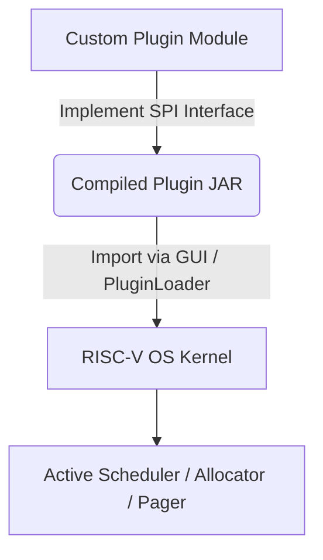

# RISC-V 32 OS Simulator: Custom Library & Plugin Development Guide

This guide details how to set up your local development environment to write, compile, and hot-swap custom OS components—specifically **Task Management (Schedulers)**, **Contiguous Memory Allocators**, and **Paged Virtual Memory Replacement Policies**—using Java Service Provider Interface (SPI) plugins.

---

## 1. Overview & Architecture

The simulator kernel relies on [PluginLoader.java](app/src/main/java/cse311/kernel/plugin/PluginLoader.java) to load custom `.jar` binary libraries dynamically at runtime using Java standard `java.util.ServiceLoader` (SPI).



### Extension Points Overview

| Subsystem             | Extension Point Interface / Abstract Class             | Mandatory SPI File Name                                |
| :-------------------- | :----------------------------------------------------- | :----------------------------------------------------- |
| **Task Management**   | `cse311.kernel.scheduler.Scheduler`                    | `cse311.kernel.scheduler.Scheduler`                    |
| **Contiguous Memory** | `cse311.kernel.contiguous.AllocationStrategy`          | `cse311.kernel.contiguous.AllocationStrategy`          |
| **Page Replacement**  | `cse311.kernel.NonContiguous.paging.ReplacementPolicy` | `cse311.kernel.NonContiguous.paging.ReplacementPolicy` |

---

## 2. Local Development Environment Setup

### Prerequisites

- **JDK:** Java 17 or higher [Java JDK Download](https://www.azul.com/downloads/?package=jdk#zulu), [JDK Set Up](https://docs.oracle.com/cd/F74770_01/English/Installing/p6_eppm_install_config/89522.htm)
- **Build Tool:** Gradle 8.x (using included `./gradlew`)

### Development Environment Options

You can build custom plugins using two approaches:

1. **Option 1: In-Tree Module** (inside this repository under `example-plugins/` - recommended for fastest iteration)
2. **Option 2: Standalone External Gradle Project** (an independent repository/folder outside the simulator repo)

---

### Option 1: In-Tree Setup (`example-plugins`)

If developing directly inside the simulator workspace:

#### Directory Structure

```text
example-plugins/
├── build.gradle
└── src/
    └── main/
        └── java/
            └── cse311/
                └── example/
                    ├── PrioritySchedulerExample.java
                    ├── RandomFitAllocator.java
                    └── FifoReplacementPolicyExample.java
```

> [!NOTE]
> `example-plugins` comes pre-configured with the Google `@AutoService` annotation processor. Annotating your plugin classes with `@AutoService(ExtensionPoint.class)` automatically generates the `META-INF/services/` declarations during compilation.

#### `settings.gradle` (Root Repository)

Ensure `settings.gradle` in the root workspace includes the `example-plugins` subproject:

```groovy
rootProject.name = 'CSE311'
include('app')
include('example-plugins')
```

#### `example-plugins/build.gradle`

```groovy
plugins {
    id 'java-library'
}

repositories {
    mavenCentral()
}

java {
    toolchain {
        languageVersion = JavaLanguageVersion.of(17)
    }
}

dependencies {
    compileOnly project(':app')
    compileOnly 'com.google.auto.service:auto-service-annotations:1.1.1'
    annotationProcessor 'com.google.auto.service:auto-service:1.1.1'
}

tasks.withType(Jar).configureEach {
    duplicatesStrategy = DuplicatesStrategy.EXCLUDE
}
```

> [!TIP]
> With `auto-service` enabled, annotate your plugin classes with `@AutoService(Scheduler.class)`, `@AutoService(AllocationStrategy.class)`, or `@AutoService(ReplacementPolicy.class)`. Gradle will automatically generate the corresponding `META-INF/services/` file.

---

### Option 2: Standalone External Gradle Project Setup (Step-by-Step)

To build a standalone plugin in a completely separate project directory or repository:

#### Step 1: Create Project Folder & Directory Hierarchy

Open a terminal and run:

```bash
# Create project folder
mkdir my-os-plugin
cd my-os-plugin

# Create directory structure
mkdir -p libs
mkdir -p src/main/java/com/mycompany/os
mkdir -p src/main/resources/META-INF/services
```

#### Step 2: Obtain the Simulator API Dependency (`app.jar`)

Build the simulator core JAR in the main repository:

```bash
./gradlew :app:jar
```

Copy `app/build/libs/app.jar` from the main repository into the `libs/` folder of your standalone `my-os-plugin` project:

```text
my-os-plugin/
└── libs/
    └── app.jar
```

#### Step 3: Create `settings.gradle`

Create `my-os-plugin/settings.gradle`:

```groovy
rootProject.name = 'my-os-plugin'
```

#### Step 4: Create `build.gradle`

Create `my-os-plugin/build.gradle`:

```groovy
plugins {
    id 'java-library'
}

java {
    toolchain {
        languageVersion = JavaLanguageVersion.of(17)
    }
}

repositories {
    mavenCentral()
}

dependencies {
    // Compile against the simulator API JAR stored in libs/
    compileOnly files('libs/app.jar')
}

jar {
    archiveBaseName = 'my-os-plugin'
    archiveVersion = '1.0.0'
}
```

#### Step 5: Initialize Gradle Wrapper (Optional but Recommended)

Initialize the Gradle wrapper in your standalone folder:

```bash
gradle wrapper --gradle-version 8.5
```

#### Step 6: Create Implementation & Service Registration Files

1. Add your Java implementation file to `src/main/java/com/mycompany/os/MyCustomScheduler.java`.
2. Add your SPI declaration file to `src/main/resources/META-INF/services/cse311.kernel.scheduler.Scheduler` containing:
   ```text
   com.mycompany.os.MyCustomScheduler
   ```

#### Step 7: Compile Standalone JAR

Run the build command inside `my-os-plugin`:

```bash
./gradlew jar
```

The compiled plugin JAR will be produced at:
`my-os-plugin/build/libs/my-os-plugin-1.0.0.jar`

---

---

## 3. Writing Custom OS Modules

### A. Task Management (Custom Scheduler)

To create a custom process/task scheduler, extend [Scheduler.java](app/src/main/java/cse311/kernel/scheduler/Scheduler.java):

```java
package com.custom.os;

import java.util.Collection;
import java.util.Collections;
import java.util.Comparator;
import java.util.PriorityQueue;

import com.google.auto.service.AutoService;
import cse311.kernel.process.Task;
import cse311.kernel.scheduler.Scheduler;
import cse311.kernel.scheduler.SchedulerStats;

/**
 * Custom priority scheduler.
 * Implements all abstract methods of Scheduler and ensures thread-safety.
 */
@AutoService(Scheduler.class)
public class CustomPriorityScheduler extends Scheduler {

    private final PriorityQueue<Task> readyQueue = new PriorityQueue<>(
            Comparator.comparingInt(Task::getPriority));
    private int scheduleCount = 0;

    // Public or protected no-arg constructor required for Java SPI
    public CustomPriorityScheduler() {
        super();
    }

    @Override
    public synchronized Task schedule() {
        if (readyQueue.isEmpty()) {
            return null;
        }
        scheduleCount++;
        return readyQueue.poll();
    }

    @Override
    public synchronized void addTask(Task task) {
        if (task != null && !readyQueue.contains(task)) {
            readyQueue.add(task);
        }
    }

    @Override
    public synchronized void removeTask(Task task) {
        if (task != null) {
            readyQueue.remove(task);
        }
    }

    @Override
    public synchronized Collection<Task> getReadyTasks() {
        return Collections.unmodifiableCollection(readyQueue);
    }

    @Override
    public synchronized SchedulerStats getStats() {
        return new SchedulerStats(scheduleCount, 0, 0, "CustomPriorityScheduler");
    }
}
```

> [!TIP]
> **SPI Registration:**
> - If developing inside `example-plugins/`, `@AutoService(Scheduler.class)` generates the SPI registration automatically.
> - If developing in a standalone project without AutoService, create the file `src/main/resources/META-INF/services/cse311.kernel.scheduler.Scheduler` containing:
>   ```text
>   com.custom.os.CustomPriorityScheduler
>   ```

---

### B. Contiguous Memory Management (Custom Memory Allocator)

To write custom allocation policies (e.g. Next-Fit, Best-Fit, Random-Fit), implement [AllocationStrategy.java](app/src/main/java/cse311/kernel/contiguous/AllocationStrategy.java). Refer to [RandomFitAllocator.java](example-plugins/src/main/java/cse311/example/RandomFitAllocator.java) for reference:

```java
package com.custom.os;

import java.util.List;

import com.google.auto.service.AutoService;
import cse311.kernel.contiguous.AllocationStrategy;
import cse311.kernel.contiguous.MemoryBlock;

@AutoService(AllocationStrategy.class)
public class BestFitAllocator implements AllocationStrategy {

    @Override
    public int findRegion(List<MemoryBlock> holes, int requestSize) {
        if (holes == null || holes.isEmpty() || requestSize <= 0) {
            return -1;
        }

        int bestAddress = -1;
        int minHoleSize = Integer.MAX_VALUE;

        for (MemoryBlock hole : holes) {
            if (hole != null && hole.size >= requestSize && hole.size < minHoleSize) {
                minHoleSize = hole.size;
                bestAddress = hole.start;
            }
        }
        return bestAddress;
    }
}
```

> [!TIP]
> **Manual SPI Registration (Standalone projects):** Create `src/main/resources/META-INF/services/cse311.kernel.contiguous.AllocationStrategy` containing:
> ```text
> com.custom.os.BestFitAllocator
> ```

---

### C. Virtual Memory Management (Custom Page Replacement Policy)

To implement custom page eviction algorithms (e.g., FIFO, LRU, LFU, Second-Chance), implement [ReplacementPolicy.java](app/src/main/java/cse311/kernel/NonContiguous/paging/ReplacementPolicy.java):

```java
package com.custom.os;

import java.util.function.IntPredicate;

import com.google.auto.service.AutoService;
import cse311.kernel.NonContiguous.paging.ReplacementPolicy;

@AutoService(ReplacementPolicy.class)
public class CustomLRUReplacementPolicy implements ReplacementPolicy {

    private final long[] lastAccessTime = new long[1024];
    private long counter = 0;

    // Public no-arg constructor required for Java SPI
    public CustomLRUReplacementPolicy() {
    }

    @Override
    public synchronized void onAccess(int frameIndex) {
        if (frameIndex >= 0 && frameIndex < 1024) {
            lastAccessTime[frameIndex] = ++counter;
        }
    }

    @Override
    public synchronized void onMap(int frameIndex) {
        onAccess(frameIndex);
    }

    @Override
    public synchronized void onUnmap(int frameIndex) {
        if (frameIndex >= 0 && frameIndex < 1024) {
            lastAccessTime[frameIndex] = 0;
        }
    }

    @Override
    public synchronized int pickVictim(IntPredicate canEvict) {
        int victimIndex = -1;
        long minTime = Long.MAX_VALUE;

        for (int i = 0; i < 1024; i++) {
            if (canEvict.test(i) && lastAccessTime[i] < minTime) {
                minTime = lastAccessTime[i];
                victimIndex = i;
            }
        }
        return victimIndex;
    }
}
```

> [!TIP]
> **Manual SPI Registration (Standalone projects):** Create `src/main/resources/META-INF/services/cse311.kernel.NonContiguous.paging.ReplacementPolicy` containing:
> ```text
> com.custom.os.CustomLRUReplacementPolicy
> ```

---

## 4. Building the Plugin JAR

Build the plugin binary by executing Gradle from the repository root:

```bash
# Build example-plugins submodule
./gradlew :example-plugins:jar
```

Or on Windows:

```powershell
.\gradlew.bat :example-plugins:jar
```

The resulting compiled library file will be located at:
`example-plugins/build/libs/example-plugins.jar`

---

## 5. Loading & Hot-Swapping into the Simulator

Once compiled, load your library directly into the active simulator environment via the Graphical User Interface (GUI) or the programmatic Java API.

### Option A: Using the Graphical User Interface (GUI)

The simulator includes first-class GUI integration for importing, managing, and hot-swapping plugins in [MainController.java](app/src/main/java/cse311/gui/MainController.java).

#### 1. The `Plugins` Menu
Located on the top menu bar:
- **`Plugins -> Manage Plugins...`**: Central control hub for viewing active plugins, resetting to defaults, or auto-detecting components.
- **`Plugins -> Import Custom Scheduler...`**: Directly open a file chooser to load and activate a `Scheduler` JAR.
- **`Plugins -> Import Custom Memory Allocator...`**: Directly open a file chooser to load and activate an `AllocationStrategy` JAR (prompts to switch to Contiguous mode if currently in Paging mode).
- **`Plugins -> Import Page Replacement Policy...`**: Directly open a file chooser to load and activate a `ReplacementPolicy` JAR (prompts to switch to Paging mode if currently in Contiguous mode).

#### 2. The "Manage Plugins" Control Dialog (Recommended)
Selecting **`Plugins -> Manage Plugins...`** opens the plugin control center:

| Control | Description |
| :--- | :--- |
| **Status Rows** | Displays the currently active algorithm for each subsystem (`CPU Scheduler`, `Contiguous Allocator`, and `Page Replacement`). |
| **`[Import JAR...]`** | Opens a file chooser to load a new custom `.jar` for that specific subsystem. |
| **`[Reset to Default]`** | Instantly reverts the subsystem back to built-in simulator defaults (`RoundRobinScheduler`, `FirstFitStrategy`, or `ClockPolicy`) without restarting the simulation or resetting loaded processes. |
| **`[Import Any Plugin JAR (Auto-Detect)...]`** | Universal loader: inspects the selected JAR's declared services. If one service is found, it activates it immediately; if multiple components are bundled in the JAR, a selection dialog lets you choose which to activate. |

#### 3. Real-Time Dashboard Status Indicators
Once loaded, active algorithms are permanently displayed in the dashboard section headers:
- **Scheduler Header:** `Scheduler Queues (RoundRobinScheduler)` updates to `Scheduler Queues (PrioritySchedulerExample)`.
- **Memory Header:** `Memory Visualization (FirstFitStrategy)` updates to `Memory Visualization (RandomFitAllocator)`.

#### 4. Automatic Mode Switching & Frame Synchronization
- **Contiguous Allocators:** Require **Contiguous Memory Mode**. If the simulator is in Paging mode, confirming the mode switch automatically restarts into Contiguous mode and **seamlessly re-opens the file chooser** so you don't lose your import action.
- **Page Replacement Policies:** Require **Paging Memory Mode**. When hot-swapping into an active simulation, the simulator automatically synchronizes all currently mapped resident frames to the new policy so active processes continue running smoothly.
- **CPU Schedulers:** Can be hot-swapped at any time while the simulation is running or paused. The kernel automatically pauses execution, migrates all tasks from the old ready queue to the new scheduler, and resumes execution.

#### 5. Windows Zero-Lock Fast Iteration Workflow
The simulator uses temporary runtime cache copies to load plugin JARs. **The source JAR file is never locked on disk.**
1. Leave the simulator GUI running.
2. Edit your plugin code in your IDE or editor.
3. Recompile in your terminal:
   ```powershell
   .\gradlew.bat :example-plugins:jar
   ```
4. In the simulator GUI, click **Plugins -> Manage Plugins... -> Import JAR...** (or re-run import). The new version activates immediately without restarting the simulator!

---

### Option B: Programmatic Loading API

You can also programmatically load plugins inside your unit tests or custom bootstrap scripts using [PluginLoader.java](app/src/main/java/cse311/kernel/plugin/PluginLoader.java):

```java
File jarFile = new File("example-plugins/build/libs/example-plugins.jar");

// 1. Inspect JAR capabilities before loading
PluginLoader.PluginManifest manifest = PluginLoader.inspectJar(jarFile);
boolean hasSched = manifest.hasScheduler();

// 2. Load custom scheduler
Scheduler customScheduler = PluginLoader.loadCustomScheduler(jarFile);
kernel.setScheduler(customScheduler);

// 3. Load custom memory allocator
AllocationStrategy customAllocator = PluginLoader.loadCustomAllocator(jarFile);
((ContiguousMemoryManager) kernel.getMemory()).setAllocationStrategy(customAllocator);

// 4. Load custom page replacement policy
ReplacementPolicy customPolicy = PluginLoader.loadCustomReplacementPolicy(jarFile);
PagedMemoryManager pmm = (PagedMemoryManager) kernel.getMemory();
// Sync existing resident frames
for (int i = 0; i < pmm.getTotalFrames(); i++) {
    if (pmm.getFrameOwner(i) != null) {
        customPolicy.onMap(i);
    }
}
pmm.setPager(new DemandPager(pmm, customPolicy));
```

---

## 6. Debugging & Verification Checklist

- [ ] **No-Arg Constructor:** Ensure your custom class has a public or protected no-argument constructor (required by Java SPI).
- [ ] **Implement All Abstract Methods:**
  - For `Scheduler`: ensure `schedule()`, `addTask()`, `removeTask()`, `getReadyTasks()`, and `getStats()` are all implemented.
  - For `AllocationStrategy`: ensure `findRegion(holes, size)` handles empty hole lists safely.
  - For `ReplacementPolicy`: ensure `onAccess()`, `onMap()`, `onUnmap()`, and `pickVictim()` are implemented.
- [ ] **Multi-Core Thread Safety:** Mark your scheduler or stateful methods as `synchronized` or use concurrent collections since multiple CPU cores access them concurrently.
- [ ] **SPI Registration:**
  - In `example-plugins/`: use `@AutoService(ExtensionPoint.class)`.
  - In standalone projects: verify `META-INF/services/<FullyQualifiedInterface>` exists and contains the exact class name.
- [ ] **Classpath Visibility:** Import core contracts from `cse311.kernel.*`.
- [ ] **Live UI Feedback:** Check that the section header updates (e.g. `Scheduler Queues (<ClassName>)`) and check console logs for `Kernel: Hot-swapped to <ClassName>`.
